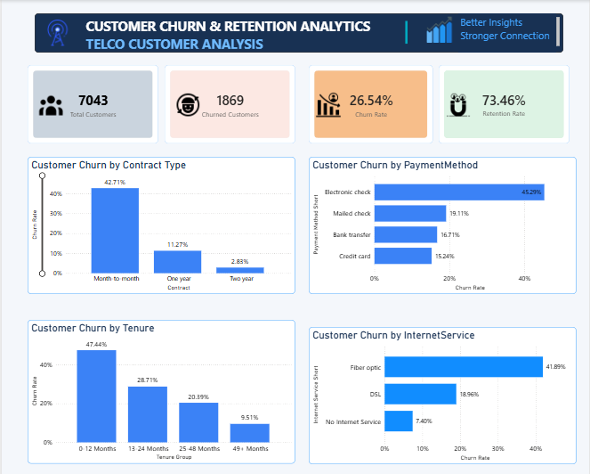

# Customer-Churn-Retention-Analytics

Project Overview

This project analyzes customer churn to identify the factors that influence customers to leave a telecommunications company. The goal is to discover useful insights and suggest strategies to improve customer retention.

Tools & Technologies

- MySQL
- Microsoft Excel
- Power BI
- DAX
- Power Query

Dataset

The project uses the Telco Customer Churn dataset, which contains 7,043 customer records.

Key Findings

- Overall customer churn rate: 26.54%
- Month-to-month contract churn rate: 42.71%
- Electronic check payment churn rate: 45.29%
- Customers with 0–12 months of tenure have a churn rate of 47.44%.
- Fiber optic customers have a churn rate of 41.89%.

Business Recommendations

- Improve support for new customers.
- Encourage customers to choose long-term contracts.
- Investigate issues affecting electronic check users.
- Review the service experience of fiber optic customers.

Project Status
In Progress

Author

ICT Undergraduate | Aspiring Data Analyst

## Power BI Dashboard

This dashboard analyzes customer churn and retention patterns using Power BI.

